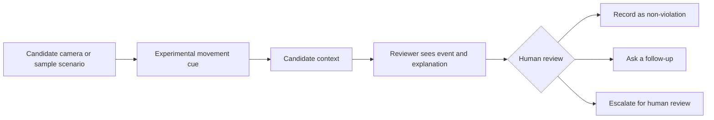

# FairSignal | Candidate-First Review for Remote Assessments 🧭

[](https://react.dev/)
[](https://www.typescriptlang.org/)
[](https://vite.dev/)
[](https://ai.google.dev/edge/mediapipe/solutions/vision/face_landmarker)
[](#prototype-scope)

> **Movement is a signal to ask, not a reason to accuse.**

**Live demo:** [Open FairSignal](https://ais-dev-bfehuu5hejuh7drwvtlet5-496679207933.asia-southeast1.run.app/)
**Repository:** [Bhanvi08/Fair-Signal](https://github.com/Bhanvi08/Fair-Signal)

## 📝 Project Overview

High-stakes online assessments can make ordinary actions such as stretching, taking a sip of water, or reacting to a sneeze feel risky when a movement cue is treated as a conclusion. I built FairSignal to explore a more candidate-aware alternative: show the moment, invite context, and let a human reviewer consider both before making a determination.

FairSignal is a **workflow and interaction prototype**, not a more accurate facial-recognition model. Its central idea is the context step between a movement cue and a review decision.

## ✨ Candidate-to-reviewer flow

1. **Candidate starts the camera** by choice. The browser asks for permission only after the button is pressed.

1. **A movement cue appears.** The prototype uses experimental browser-side heuristics; sample scenarios are available if the camera is unavailable or the user does not want to use it.

1. **The candidate adds context.** They can confirm or change a category, write a note, or select “Prefer not to say.”

1. **A human reviewer sees the event and context together.** The reviewer can record a non-violation, ask a follow-up, or escalate for further human review.



## 🛠️ System Architecture & Core Tech Stack

| Module | What it does | Implementation |
| --- | --- | --- |
| Candidate demo | Camera preview, sample scenarios, category confirmation, and context entry | React component using browser `getUserMedia` |
| Motion cues | Estimates coarse changes from a starting posture; labels are experimental | MediaPipe Face Landmarker plus canvas frame-difference heuristics |
| Reviewer view | Shows the event timeline with candidate context and reviewer actions | React state and reviewer UI |
| Demo state | Keeps new events and reviewer decisions for the active session | In-memory frontend state; no API or database |

**Stack:** React 19, TypeScript, Vite 8, Tailwind CSS, and MediaPipe Tasks Vision.

## 🔬 Engineering Logic Employed

- Requests **video only**; audio is disabled in the camera constraints.

- Establishes an initial landmark baseline, then applies simple movement heuristics to flag a cue for the candidate workflow.

- Runs a low-resolution canvas frame-difference path so the interaction can still demonstrate coarse movement when the MediaPipe model is unavailable.

- Provides explicit sample buttons for stretching, getting water, sneezing, and other movement. These scenarios are labeled as samples and do not require the camera.

- Keeps the reviewer’s action human-controlled. The prototype does not calculate a misconduct score or automatically disqualify a candidate.

## 📌 Project Scope & Benchmark Boundary

FairSignal is **not** an identity-recognition system and does not use Eigenfaces, PCA, or an MLP. It has no recognition-accuracy result, and no accuracy figure from another project should be attributed to this repository.

For clarity, the **47.22% and 54.44% results belong to my separate **[**Facial Recognition System | Eigenfaces & ANN**](https://github.com/Bhanvi08/Facial-Recognition-PCA-ANN/blob/main/iStudio.ipynb), specifically the initial 50-component ANN evaluation and the later “Accuracy vs. K-Value” sweep in `iStudio.ipynb`. They are not FairSignal metrics. The saved notebook outputs also show 46.11% for `k=50` inside the sweep, so those outputs should not be presented as a controlled 47.22% → 54.44% gain without a reproducible rerun. FairSignal’s contribution is the candidate-context and human-review workflow, not a facial-recognition accuracy improvement.

## 🔐 Privacy & Prototype Limitations

- The app processes the camera stream in the browser. The current frontend has no backend endpoint that uploads or stores camera video.

- Candidate events and notes exist only in frontend memory for the demo session; reloading or resetting clears them.

- When camera mode starts, the browser downloads MediaPipe runtime files from jsDelivr and the face-landmark model from Google Cloud Storage. These are model assets; this code does not send the camera feed to those hosts.

- Motion labels are heuristic and can be wrong. Camera angle, lighting, face visibility, posture, and unrelated movement can affect them.

- This is not a validated proctoring system. It should not be used to make real assessment, academic-integrity, or employment decisions.

## 🚀 Future Roadmap

- Test the interaction with consenting candidates and reviewers, including accessibility and non-camera alternatives.

- Measure false alerts across varied devices, lighting, camera placement, and movement before making any detection-performance claims.

- Improve the candidate’s ability to correct or decline a context label, and make the review sequence easier to audit.

- Define security, consent, retention, and deletion policies before considering any backend or real assessment use.

## ⚙️ Run Locally

**Requirements:** Node.js 20.19+ or 22.12+, npm, and a modern browser.

```bash
npm ci
npm run dev
```

Open the local address printed by Vite. The project defaults to `http://localhost:3000/`.

To validate the project:

```bash
npm run build
npm run lint
```

The current frontend does not require a Gemini API key or an `.env.local` file. The `.env.example` file is leftover AI Studio scaffolding and is not required to run this app.

### Camera troubleshooting

Use the direct site in a normal tab, not an embedded preview, and allow camera access in the browser’s site settings. `localhost` is treated as a secure context; a deployed camera demo must use HTTPS. The sample-scenario buttons can be used without camera permission.

## 👩‍💻 Author

**Bhanvi Singh Chauhan**
[GitHub](https://github.com/Bhanvi08) · [LinkedIn](https://www.linkedin.com/in/bhanvi-singh-chauhan-2394472b4)
